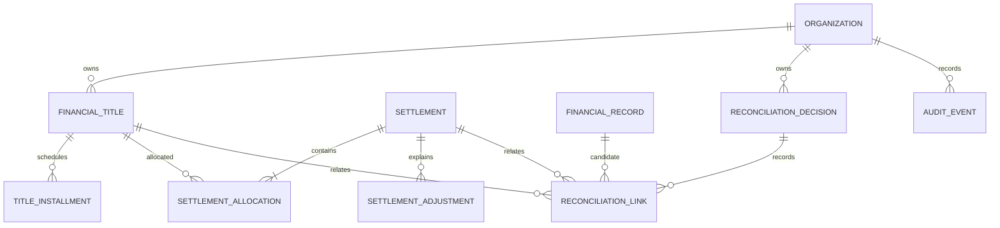

# F01.1 — Modelo de Domínio Financeiro

**Versão:** 0.1  
**Status:** Proposta para revisão — não aprovada para implementação  
**Base de análise:** `main` do RSBUILD Finance, referência consultada em 2026-11-12  
**Escopo:** modelagem conceitual de contas a pagar/receber, liquidações e decisões de conciliação.

> Este documento especifica o domínio. Não cria tabelas, migrations, endpoints, políticas RLS ou alterações no Supabase. Nenhuma decisão de negócio pendente deve ser inferida como aprovada.

## 1. Objetivo e fronteiras

F01 introduz um ciclo financeiro persistente sem confundir quatro conceitos:

1. **Título financeiro:** direito a receber ou obrigação a pagar, originado por contrato, nota, fatura, folha, lançamento manual ou integração.
2. **Movimentação bancária:** fato observado em extrato/importação, já representado em `financial_records`.
3. **Liquidação:** evento financeiro que registra quanto de um ou mais títulos foi efetivamente pago/recebido, quando e por qual meio.
4. **Decisão de conciliação:** decisão auditável que relaciona evidências (título, liquidação, movimentação) ou registra que a relação não pôde ser confirmada.

A existência de uma movimentação não liquida automaticamente um título. Uma sugestão algorítmica não é uma decisão confirmada. Exportar um arquivo para ERP não equivale a executar uma baixa no ERP.

### Fora do escopo desta etapa

- DRE, classificação contábil e regras fiscais.
- Integração operacional de escrita com Omie ou bancos.
- Contabilização por competência, plano de contas e partidas dobradas.
- Cálculo automático de juros/multas segundo legislação ou contrato.
- Multi-moeda operacional, câmbio e hedge.
- Migrações e alterações de banco.

## 2. Evidência atual e implicações

A estrutura existente em `main` inclui organizações/memberships, contas financeiras, fontes, lotes de importação, artefatos, movimentações em `financial_records`, execuções/linhas de integração e `audit_events`. Valores de movimentações são persistidos em unidades menores inteiras (centavos), com moeda.

A lógica de títulos em `lib/reconciliation.ts` define atualmente um tipo transitório de título a receber e calcula sugestões contra registros bancários. A tela de baixas informa que títulos e decisões são temporários na sessão; a confirmação marca títulos como baixados somente na sessão e a exportação gera CSV. Não foi identificado, nesta análise de código, um ciclo persistente equivalente para títulos, liquidações e alocações.

Consequência: o modelo proposto deve integrar-se às entidades existentes por chaves compostas de organização, preservando `financial_records` como fonte de movimentações. Não duplicar extratos dentro da entidade de título.

## 3. Modelo conceitual

A relação entre liquidação e título é resolvida por **alocação**. Isso permite pagamentos parciais, um pagamento para vários títulos e múltiplas liquidações para um mesmo título. O vínculo com movimentação bancária fica na conciliação, não é pressuposto obrigatório da liquidação (por exemplo, pagamento em caixa ou liquidação manual documentada).

## 4. Entidades propostas

### 4.1 FinancialTitle — título financeiro

Representa um direito ou obrigação original.

Campos conceituais:
- `id`, `organization_id`: identidade e escopo tenant.
- `direction`: `receivable` ou `payable`.
- `document_type`, `document_number`, `external_reference`: identificação da origem, quando houver.
- `counterparty_id` ou snapshot de contraparte: cliente/fornecedor; a estratégia de cadastro mestre precisa ser decidida.
- `description`, `issue_date`, `competence_date`, `due_date`.
- `original_amount_minor`, `currency`: valor original em centavos inteiros e moeda ISO.
- `status`: estado operacional derivado/controlado.
- `source_type`, `data_source_id`, `import_batch_id`, `source_artifact_id`: proveniência opcional.
- `created_by`, `created_at`, `updated_at`, `version`.

O título é imutável quanto à sua origem econômica após confirmação, salvo correção auditada. Alterações de saldo devem decorrer de liquidações, ajustes autorizados ou cancelamento/estorno — não de sobrescrita silenciosa do valor original.

### 4.2 TitleInstallment — parcela / vencimento

Representa a obrigação ou direito com vencimento próprio. Um título pode ter uma parcela ou várias.

Campos conceituais:
- `id`, `organization_id`, `financial_title_id`.
- `installment_number`, `due_date`, `scheduled_amount_minor`, `currency`.
- `status` (aberta, parcialmente liquidada, liquidada, cancelada).
- `created_at`, `updated_at`.

Se o negócio decidir que cada parcela importada do ERP já é um título independente, essa entidade poderá ser dispensada inicialmente. Não assumir essa decisão sem validar os arquivos reais de origem.

### 4.3 Settlement — liquidação

Evento confirmado de pagamento ou recebimento. Não é sinônimo de baixa exportada nem de movimentação bancária.

Campos conceituais:
- `id`, `organization_id`.
- `settlement_type`: pagamento ou recebimento.
- `settled_at`: instante/data efetiva.
- `gross_amount_minor`, `currency`.
- `payment_method`, `financial_account_id` (opcionais, conforme meio).
- `external_reference`, `source_type`, `source_payload_hash`.
- `status`: rascunho, confirmado, estornado.
- `confirmed_by`, `confirmed_at`, `reversal_of_id`.
- `created_at`, `created_by`.

Uma liquidação confirmada é append-only no sentido de negócio. Correção ocorre por estorno/reversão e novo evento, preservando a história.

### 4.4 SettlementAllocation — alocação da liquidação

Liga o valor liquidado ao título/parcela que foi satisfeito.

Campos conceituais:
- `id`, `organization_id`, `settlement_id`.
- `financial_title_id` e opcionalmente `title_installment_id`.
- `principal_amount_minor`, `discount_amount_minor`, `interest_amount_minor`, `fine_amount_minor`, `other_adjustment_minor`.
- `currency`, `created_at`.

A soma das alocações deve ser consistente com o total da liquidação, segundo uma regra de composição aprovada. Não misturar desconto/juros com principal sem discriminação. A semântica exata de sinal e composição será fechada antes da implementação.

### 4.5 SettlementAdjustment — ajuste discriminado

Opcional no MVP, mas recomendado se houver múltiplos tipos de acréscimo/desconto com origem e justificativa distintas.

Campos conceituais:
- `id`, `organization_id`, `settlement_id`, `allocation_id` opcional.
- `adjustment_type`: desconto, juros, multa, tarifa, abatimento, outro.
- `amount_minor`, `currency`, `reason`, `source_reference`, `created_at`.

Não calcular valores legais/contratuais nesta camada sem regra de negócio versionada.

### 4.6 ReconciliationDecision — decisão de conciliação

Registra a decisão humana ou automatizada sobre uma relação candidata.

Campos conceituais:
- `id`, `organization_id`.
- `status`: sugerida, confirmada, rejeitada, desfeita.
- `decision_method`: manual, regra determinística, algoritmo, integração.
- `confidence` e `rule_version` quando houver sugestão automatizada.
- `reason_code`, `justification`.
- `decided_by`, `decided_at`, `supersedes_decision_id`.
- `created_at`.

Uma sugestão nunca deve marcar título como liquidado. Confirmação exige autorização e evidência suficiente; decisões rejeitadas/desfeitas permanecem consultáveis.

### 4.7 ReconciliationLink — evidência relacionada

Associa uma decisão a uma ou mais entidades de origem: título, parcela, liquidação e/ou movimentação `financial_records`.

A implementação deve preferir FKs explícitas e restrições que impeçam referências cruzadas entre organizações. Evitar uma coluna polimórfica sem integridade referencial. A cardinalidade e as restrições de unicidade serão especificadas na etapa F01.3.

### 4.8 AuditEvent — trilha de auditoria

Reutilizar o conceito/tabela `audit_events` existente, após confirmar a política de escrita e imutabilidade. Cada criação, confirmação, estorno, alocação, decisão ou mudança de estado deve registrar ator, organização, entidade, instante, correlação e metadados mínimos. O cliente não escolhe livremente `actor_id`; o servidor deriva o ator da sessão autenticada.

## 5. Estados e transições

### Título / parcela
- `draft` → `open` após validação e confirmação de origem.
- `open` → `partially_settled` quando há alocação confirmada inferior ao saldo.
- `open | partially_settled` → `settled` quando saldo chega a zero dentro da regra de tolerância aprovada.
- `draft | open` → `cancelled` com motivo e autorização.
- `settled` não volta diretamente a `open`; exige estorno/reversão rastreável.

### Liquidação
- `draft` → `confirmed` com validação de valores, alocações, organização e permissão.
- `confirmed` → `reversed` somente por evento de reversão com ator, data e motivo.
- Não editar ou apagar liquidação confirmada para corrigir histórico.

### Conciliação
- `suggested` → `confirmed` ou `rejected` por decisão autorizada.
- `confirmed` → `undone` apenas com motivo; nova decisão substitutiva preserva a anterior.
- A confiança é metadado da sugestão, não permissão nem prova financeira.

Os nomes finais de enum e transições são decisão técnica posterior; o significado acima é a regra de domínio proposta.

## 6. Invariantes obrigatórias

1. Toda entidade financeira pertence a exatamente uma organização.
2. Toda FK entre entidades tenant-scoped valida a mesma `organization_id`.
3. Valores monetários são inteiros em centavos (`bigint` no banco), moeda explícita; não usar ponto flutuante para persistência/cálculo.
4. Não somar moedas diferentes sem conversão explícita e taxa versionada — fora do MVP.
5. Valor original do título não é sobrescrito por pagamento; saldo é calculado a partir de alocações válidas.
6. Alocação confirmada não pode exceder saldo aberto do título/parcela, salvo regra formal para crédito/adiantamento.
7. Uma liquidação confirmada deve ter uma ou mais alocações ou uma justificativa de não alocação aprovada (decisão pendente).
8. Total de alocações e ajustes deve fechar com o valor liquidado segundo composição formal definida.
9. Um mesmo movimento bancário não pode ser consumido duas vezes por conciliações confirmadas incompatíveis, salvo split explícito e modelado.
10. Sugestão automática não altera estado financeiro.
11. Estorno preserva o evento original e reverte seus efeitos uma única vez.
12. Operações críticas são transacionais, idempotentes e auditadas.
13. `organization_id`, ator e permissões são validados no servidor; não confiar em IDs enviados pelo browser.
14. Importação repetida deve ser idempotente por chave de origem dentro da organização, sem fundir registros de origens distintas por heurística fraca.

## 7. Permissões propostas

| Ação | Owner | Admin | Operator | Viewer |
|---|---:|---:|---:|---:|
| Consultar títulos/liquidações/decisões | Sim | Sim | Sim | Sim |
| Criar/importar título | Sim | Sim | Sim | Não |
| Editar título em rascunho | Sim | Sim | Sim | Não |
| Cancelar título confirmado | Sim | Sim, conforme política | Não por padrão | Não |
| Registrar liquidação em rascunho | Sim | Sim | Sim | Não |
| Confirmar liquidação | Sim | Sim, conforme alçada | Pendente de decisão | Não |
| Estornar liquidação | Sim | Pendente de alçada | Não | Não |
| Confirmar/rejeitar conciliação | Sim | Sim | Pendente por valor/risco | Não |
| Gerir membros/permissões | Conforme política existente | Conforme política existente | Não | Não |

Esta matriz é proposta de domínio e não substitui nem altera `lib/permissions.ts` ou RLS. Aprovação por valor, dupla aprovação e segregação entre criador/aprovador precisam de decisão do negócio.

## 8. Cenários de aceite para F01.1

- Criar um título a receber e um a pagar em organizações distintas; confirmar isolamento.
- Representar um título parcelado sem perder o valor total original.
- Receber parcialmente um título e calcular saldo restante sem alterar o principal.
- Liquidar vários títulos com um pagamento agrupado, preservando a alocação por título.
- Registrar juros, multa e desconto separadamente, com fechamento matemático.
- Tentar alocar acima do saldo e receber rejeição transacional.
- Tentar relacionar entidades de organizações diferentes e receber rejeição.
- Confirmar que uma sugestão de conciliação não liquida o título.
- Estornar liquidação e restaurar saldo de forma idempotente e auditada.
- Repetir uma operação com a mesma chave idempotente sem duplicar liquidação/alocação.
- Verificar autoria derivada da sessão e trilha de auditoria.

## 9. Decisões de negócio que bloqueiam o esquema definitivo

| ID | Decisão | Opções / impacto |
|---|---|---|
| B01 | Unidade de gestão: título ou parcela? | Título com parcelas; ou cada parcela do ERP como título independente. Impacta entidades e importação. |
| B02 | Liquidação sem movimento bancário é permitida? | Sim, com meio/evidência; ou exigir movimento conciliado. Impacta fluxo caixa/caixa físico. |
| B03 | Pagamento/recebimento parcial e agrupado? | Recomendado suportar ambos desde o modelo inicial. |
| B04 | Adiantamentos e créditos sem título? | Exigir conta transitória/crédito não aplicado; fora do MVP ou incluído. |
| B05 | Tolerância de arredondamento/saldo residual? | Definir centavos, arredondamento e autorização para baixa de resíduo. |
| B06 | Alçada de confirmação/estorno? | Por perfil, valor, criador diferente do aprovador e/ou dupla aprovação. |
| B07 | Ajustes permitidos? | Juros, multa, desconto, tarifa, retenções, abatimentos e outros. Definir incidência e sinal. |
| B08 | Cancelamento após liquidação? | Bloquear; ou exigir estorno antes do cancelamento. |
| B09 | Cadastro de contraparte? | Mestre próprio, snapshot no título ou referência externa. |
| B10 | Moedas no MVP? | BRL apenas (recomendado) ou multi-moeda desde início. |
| B11 | Competência e data de caixa? | Manter emissão/competência/vencimento separadas de data efetiva de liquidação. |
| B12 | Origem/ERP e identificadores? | Definir chave estável por fonte e política de atualização de títulos importados. |

## 10. Próxima sequência técnica

1. Validar B01–B12 com responsáveis financeiros e amostras anonimizadas de títulos (Omie e outras origens).
2. Converter o modelo aprovado em ERD lógico e dicionário de dados.
3. Definir constraints, índices, idempotência, RLS e matriz de permissões por operação.
4. Especificar contratos de comandos transacionais (criar, confirmar, alocar, estornar) e respostas de erro.
5. Criar cenários automatizados, incluindo dois tenants e concorrência de liquidação.
6. Só então propor migrations incrementais em branch isolada e ambiente de desenvolvimento autorizado.

## 11. Referências internas examinadas

- `supabase/migrations/20261104210850_d02_managed_persistence.sql`
- `supabase/migrations/20261109130004_d02_transactional_imports.sql`
- `lib/finance.ts`
- `lib/finance-persistence.ts`
- `lib/reconciliation.ts`
- `app/components/finance/baixas-view.tsx`
- `docs/IMPLEMENTATION_PLAN.md`

**Nota de rastreabilidade:** F01.1 é uma especificação nova e distinta do plano legado D01–D07. A presente proposta não afirma que os cenários de aceite já foram executados.
