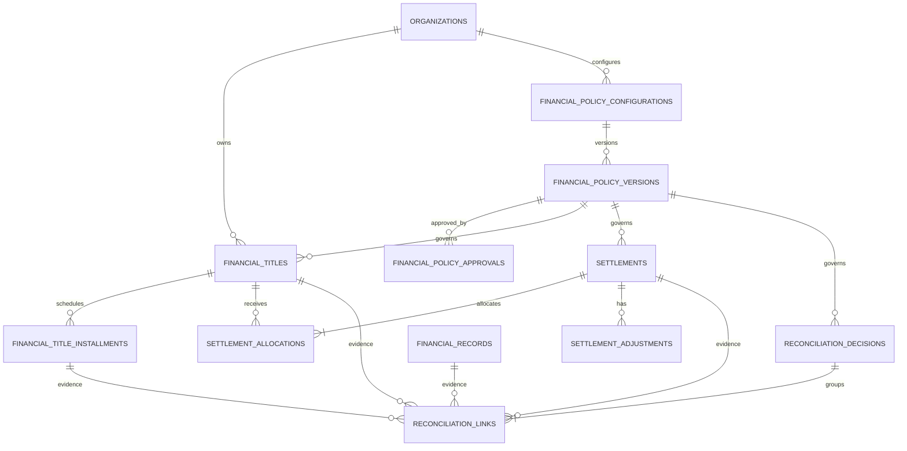

# F01.2 — Modelo Lógico de Dados Financeiros

**Versão:** 0.1  
**Status:** Proposta para revisão — não aprovada para migrations  
**Base:** F01.1 — Modelo de Domínio Financeiro; migrations D02 existentes em `main`  
**Escopo:** estrutura relacional proposta para títulos, parcelas, liquidações, conciliação e governança de políticas financeiras por organização.

> Este documento é um desenho lógico. Não cria nem altera tabelas, migrations, políticas RLS, funções, dados ou configurações do Supabase. Tipos e nomes são propostas sujeitas à revisão técnica e validação com amostras reais.

## 1. Princípios de modelagem

1. **Organização é o tenant:** toda entidade de negócio nova carrega `organization_id`.
2. **FKs compostas:** relações entre entidades tenant-scoped usam `(organization_id, id)`, impedindo vínculos entre organizações diferentes mesmo em caso de erro de aplicação.
3. **UUIDs como identidade:** IDs internos UUID; identificadores externos ficam em colunas próprias e com escopo da origem.
4. **Dinheiro sem ponto flutuante:** valores em `bigint` de unidades menores, moeda ISO 4217 explícita. Não usar `numeric` ou `float` para substituir a regra de centavos do MVP.
5. **Eventos financeiros preservados:** liquidações confirmadas, estornos, aprovações e decisões são históricos; corrigir por novos eventos, não por sobrescrita destrutiva.
6. **Estado derivado com cuidado:** saldo e estado do título decorrem de alocações válidas; qualquer cache de saldo deve ser reconciliável com o ledger de eventos.
7. **Política versionada:** cada operação relevante aponta para a versão de política efetivamente aplicada.
8. **RLS não substitui integridade:** RLS protege leitura/escrita por tenant; constraints e FKs compostas protegem relações; autorização de comandos críticos também é validada no servidor.

## 2. Estruturas existentes que serão reutilizadas

| Estrutura existente | Papel no modelo F01.2 | Observação |
|---|---|---|
| `organizations` | Tenant proprietário | UUID permanece chave de autorização; `slug` é identificador de rota, não chave relacional. |
| `organization_memberships` | Associação usuário-organização e papel base | Papéis atuais: owner, admin, operator, viewer. Permissões financeiras granulares ainda precisam ser especificadas. |
| `financial_accounts` | Contas financeiras | Reutilizar por FK composta `(organization_id,id)`. |
| `financial_records` | Movimentações bancárias importadas | Não converter nem duplicar como título ou liquidação. |
| `data_sources` | Origem de dados/ERP | Referenciar quando o título vier de uma fonte cadastrada. |
| `import_batches` | Lote de importação | Preservar proveniência do título importado. |
| `source_artifacts` | Arquivo de origem | Referenciar documento/arquivo de evidência quando aplicável. |
| `audit_events` | Trilha de auditoria existente | A tabela usa `entity_type/entity_id` textuais; F01 deve padronizar os eventos sem presumir FK forte para entidades futuras. |

### 2.1 Limites observados no schema atual

- `financial_records` já possui `organization_id`, `account_id`, `data_source_id`, `import_batch_id`, valor em unidades menores, moeda e direção. Deve continuar representando o fato bancário.
- `financial_records` tem `unique (organization_id,id)`, permitindo FKs compostas.
- `financial_accounts`, `data_sources`, `import_batches` e `source_artifacts` também possuem chaves únicas compostas por organização e ID.
- `audit_events` tem ID identity global e `organization_id`, mas não possui atualmente uma chave única composta `(organization_id,id)`; não criar FKs compostas para ela sem evolução específica.
- As migrations D02 habilitam RLS nas tabelas existentes. As novas tabelas deverão nascer com RLS habilitada e políticas específicas, além de grants mínimos.
- As migrations consultadas não apresentam tabelas persistentes de títulos, parcelas, liquidações, alocações ou versões de política financeira.

## 3. Diagrama lógico

O diagrama é conceitual: a implementação deve incluir as FKs compostas por tenant descritas abaixo. Relações opcionais e cardinalidades finais dependem das decisões listadas na seção 10.

## 4. Tabelas de domínio financeiro

### 4.1 `financial_titles` — título financeiro

| Coluna | Tipo lógico | Regras |
|---|---|---|
| `id` | uuid | PK, gerado no servidor |
| `organization_id` | uuid | NOT NULL, FK `organizations(id)` |
| `direction` | enum/check | `receivable` ou `payable` |
| `document_type` | text | Opcional; catálogo posterior |
| `document_number` | text | Opcional |
| `external_reference` | text | Identificador da origem |
| `counterparty_id` | uuid | Opcional, depende do cadastro mestre |
| `counterparty_snapshot` | jsonb | Snapshot mínimo, se aprovado como estratégia |
| `description` | text | NOT NULL |
| `issue_date` | date | Opcional |
| `competence_date` | date | Opcional |
| `due_date` | date | Opcional no cabeçalho se houver parcelas |
| `original_amount_minor` | bigint | NOT NULL, maior que zero |
| `currency` | char(3) | NOT NULL, ISO 4217 |
| `status` | enum/check | `draft`, `open`, `partially_settled`, `settled`, `cancelled` |
| `source_type` | text | Manual, ERP, importação etc. |
| `data_source_id` | uuid | FK composta opcional |
| `import_batch_id` | uuid | FK composta opcional |
| `source_artifact_id` | uuid | FK composta opcional |
| `policy_version_id` | uuid | Versão usada na criação/confirmação |
| `created_by` | uuid | Derivado da sessão no servidor |
| `created_at`, `updated_at` | timestamptz | NOT NULL |
| `version` | integer | Controle otimista de concorrência |

**Chaves e constraints propostas**
- PK `(id)` e UNIQUE `(organization_id,id)` para permitir FKs tenant-scoped.
- FK `(organization_id,data_source_id)` → `data_sources(organization_id,id)`; equivalentes para lote e artefato.
- FK `(organization_id,policy_version_id)` → `financial_policy_versions(organization_id,id)`.
- CHECK `original_amount_minor > 0`; moeda com formato de três letras maiúsculas.
- Índices por organização + direção + status + vencimento; índice de busca por contraparte e referência externa.
- Idempotência de origem: índice único parcial em `(organization_id,data_source_id,external_reference)` somente quando a origem fornecer referência estável e não nula. Não deduplicar títulos por descrição/valor/data heurísticos.

### 4.2 `financial_title_installments` — parcelas

| Coluna | Tipo lógico | Regras |
|---|---|---|
| `id` | uuid | PK |
| `organization_id` | uuid | NOT NULL |
| `financial_title_id` | uuid | NOT NULL, FK composta para título |
| `installment_number` | integer | NOT NULL, maior que zero |
| `due_date` | date | NOT NULL |
| `scheduled_amount_minor` | bigint | NOT NULL, maior que zero |
| `currency` | char(3) | NOT NULL |
| `status` | enum/check | `open`, `partially_settled`, `settled`, `cancelled` |
| `created_at`, `updated_at` | timestamptz | NOT NULL |

Constraints: UNIQUE `(organization_id,id)`; FK `(organization_id,financial_title_id)`; UNIQUE `(organization_id,financial_title_id,installment_number)`. Moeda deve coincidir com a moeda do título. A soma das parcelas deve fechar com o valor original do título antes da confirmação; validação cross-row exige comando transacional/trigger cuidadosamente desenhado, não CHECK simples.

**Regra de simplificação:** se a origem já fornece cada parcela como documento independente, a empresa poderá configurar P01 para tratar cada parcela como título autônomo. Nesse caso, não criar parcelas artificiais para essa origem.

### 4.3 `settlements` — liquidações

| Coluna | Tipo lógico | Regras |
|---|---|---|
| `id` | uuid | PK |
| `organization_id` | uuid | NOT NULL |
| `settlement_type` | enum/check | `payment` ou `receipt` |
| `settled_at` | timestamptz | NOT NULL |
| `gross_amount_minor` | bigint | NOT NULL, maior que zero |
| `currency` | char(3) | NOT NULL |
| `payment_method` | text | Conforme política vigente |
| `financial_account_id` | uuid | Opcional, FK composta |
| `external_reference` | text | Opcional |
| `source_type` | text | Manual, ERP, integração etc. |
| `source_payload_hash` | text | Opcional, para idempotência de integração |
| `status` | enum/check | `draft`, `confirmed`, `reversed` |
| `policy_version_id` | uuid | NOT NULL após confirmação |
| `created_by` | uuid | Ator validado no servidor |
| `confirmed_by` | uuid | Ator que confirmou |
| `confirmed_at` | timestamptz | Preenchido na confirmação |
| `reversal_of_id` | uuid | Referência à liquidação original, se modelado como evento de reversão |
| `idempotency_key` | text | NOT NULL para comandos externos/repetíveis |
| `created_at` | timestamptz | NOT NULL |

Constraints: UNIQUE `(organization_id,id)`; FK composta para conta financeira e versão de política; UNIQUE `(organization_id,idempotency_key)`; CHECK de coerência entre status e campos de confirmação. A reversão deve ser modelada com semântica inequívoca: ou evento compensatório separado ou relação `reversal_of_id`, sem permitir duas reversões para a mesma liquidação.

### 4.4 `settlement_allocations` — alocações

| Coluna | Tipo lógico | Regras |
|---|---|---|
| `id` | uuid | PK |
| `organization_id` | uuid | NOT NULL |
| `settlement_id` | uuid | NOT NULL, FK composta |
| `financial_title_id` | uuid | NOT NULL, FK composta |
| `title_installment_id` | uuid | Opcional, FK composta |
| `principal_amount_minor` | bigint | NOT NULL, maior ou igual a zero |
| `currency` | char(3) | NOT NULL |
| `created_at` | timestamptz | NOT NULL |

A alocação liga uma liquidação a um título e, opcionalmente, a uma parcela. A soma de principal alocado mais ajustes associados deve obedecer à composição aprovada. Moeda e direção da liquidação devem coincidir com o título/parcela. Uma alocação não pode exceder o saldo disponível.

**Decisão de modelagem:** juros, multa, desconto, tarifa e abatimento ficam em `settlement_adjustments`, vinculados à liquidação e opcionalmente à alocação. Isso evita campos de ajuste fixos e permite expandir tipos com governança. O sentido/sinal de cada ajuste será formalizado em catálogo e regra aritmética antes de migrations.

### 4.5 `settlement_adjustments` — ajustes discriminados

Colunas: `id`, `organization_id`, `settlement_id`, `allocation_id` opcional, `adjustment_type`, `amount_minor`, `currency`, `reason`, `source_reference`, `created_by`, `created_at`.

FKs compostas para liquidação e alocação. `amount_minor` deve ser não zero; a convenção de sinal não será definida implicitamente. O tipo deve estar permitido na versão de política aplicada. Alterações após confirmação exigem estorno e novo evento, não UPDATE livre.

## 5. Tabelas de conciliação

### 5.1 `reconciliation_decisions`

Colunas propostas:
- `id`, `organization_id`;
- `status`: `suggested`, `confirmed`, `rejected`, `undone`;
- `decision_method`: `manual`, `deterministic_rule`, `algorithm`, `integration`;
- `confidence` opcional, decimal limitado a 0–1;
- `rule_version` opcional;
- `reason_code`, `justification`;
- `decided_by`, `decided_at`, `supersedes_decision_id`;
- `policy_version_id`;
- `created_at`.

FK composta para versão de política e auto-FK composta para decisão substituída. Uma sugestão automatizada pode existir sem ator humano, mas decisão confirmada/rejeitada deve registrar o principal responsável e o instante. Confiança não concede autorização.

### 5.2 `reconciliation_links`

Colunas propostas:
- `id`, `organization_id`, `reconciliation_decision_id`;
- `financial_title_id` opcional;
- `title_installment_id` opcional;
- `settlement_id` opcional;
- `financial_record_id` opcional;
- `link_role` (ex.: candidate, supporting_evidence, matched);
- `created_at`.

Cada linha aponta para exatamente uma entidade de evidência, validada por uma FK composta. CHECK exige exatamente uma das quatro colunas de referência não nula. A decisão pode ter múltiplos links. Índices por organização e por cada FK. A regra para impedir consumo duplicado de movimentação será implementada por comando transacional e/ou constraint parcial após definir se um movimento pode ser dividido entre várias liquidações. Não presumir exclusividade absoluta antes dessa decisão.

## 6. Configuração e governança de políticas

### 6.1 `financial_policy_configurations`

Uma linha por organização e módulo:
- `id` uuid PK;
- `organization_id` uuid NOT NULL;
- `module_key` text NOT NULL, inicialmente `finance`;
- `status`: `not_started`, `in_progress`, `pending_approval`, `active`, `change_pending`, `suspended`;
- `active_version_id` uuid opcional;
- `created_at`, `updated_at`.

UNIQUE `(organization_id,module_key)`, UNIQUE `(organization_id,id)`. A organização pode ter uma configuração financeira ativa por módulo.

### 6.2 `financial_policy_versions`

Uma versão imutável por configuração:
- `id`, `organization_id`, `configuration_id`;
- `version_number` integer;
- `schema_version` text;
- `policy_payload` jsonb validado no servidor contra schema versionado;
- `status`: `draft`, `pending_approval`, `approved`, `active`, `rejected`, `superseded`;
- `change_reason`, `created_by`, `created_at`;
- `approved_at`, `effective_from`, `effective_until`.

UNIQUE `(organization_id,id)`; UNIQUE `(organization_id,configuration_id,version_number)`; FK composta para configuração. Payload não é JSON livre: deve ter schema conhecido, valores tipados, enums permitidos, validação de dependências e registro de versão do schema. Versões aprovadas/ativas não podem ser editadas.

### 6.3 `financial_policy_approvals`

Registro append-only:
- `id`, `organization_id`, `policy_version_id`;
- `decision`: `approved` ou `rejected`;
- `approver_user_id`;
- `authority_type`: papel direto ou delegação formal;
- `delegation_id` opcional;
- `justification`, `decided_at`.

FK composta para versão; UNIQUE apropriada para impedir duplicação da mesma decisão pelo mesmo aprovador, sem impedir trilha de decisões posteriores formalmente permitidas. A aprovação valida associação ativa, permissão específica e delegação vigente no servidor.

### 6.4 `financial_policy_delegations` (se necessária após validação do RBAC)

- `id`, `organization_id`, `delegated_user_id`, `granted_by`;
- `scope` (configurar, submeter, aprovar, administrar);
- `valid_from`, `valid_until`, `revoked_at`, `reason`, `created_at`.

Não tratar a role `admin` atual como sinônimo automático de diretoria. A delegação deve ter escopo, prazo e trilha. Se o modelo central de permissões já suportar delegações equivalentes, reutilizá-lo em vez de criar duplicidade.

## 7. Relacionamentos e integridade tenant-scoped

Todas as tabelas novas devem declarar `UNIQUE (organization_id,id)` quando forem alvo de FKs compostas. Relações mínimas:

| Origem | FK composta | Destino |
|---|---|---|
| financial_titles | (organization_id,data_source_id) | data_sources |
| financial_titles | (organization_id,import_batch_id) | import_batches |
| financial_titles | (organization_id,source_artifact_id) | source_artifacts |
| financial_titles | (organization_id,policy_version_id) | financial_policy_versions |
| financial_title_installments | (organization_id,financial_title_id) | financial_titles |
| settlements | (organization_id,financial_account_id) | financial_accounts |
| settlements | (organization_id,policy_version_id) | financial_policy_versions |
| settlement_allocations | (organization_id,settlement_id) | settlements |
| settlement_allocations | (organization_id,financial_title_id) | financial_titles |
| settlement_allocations | (organization_id,title_installment_id) | financial_title_installments |
| settlement_adjustments | (organization_id,settlement_id) | settlements |
| reconciliation_decisions | (organization_id,policy_version_id) | financial_policy_versions |
| reconciliation_links | (organization_id,reconciliation_decision_id) | reconciliation_decisions |
| reconciliation_links | (organization_id,financial_record_id) | financial_records |

Para `reconciliation_links`, adicionar FKs compostas equivalentes para título, parcela e liquidação. Não usar FK polimórfica textual como única garantia de integridade.

## 8. Índices e unicidade — proposta inicial

- Títulos: `(organization_id,direction,status,due_date)`; `(organization_id,created_at desc)`; referência externa por origem quando estável.
- Parcelas: `(organization_id,financial_title_id,due_date)`; unicidade do número da parcela por título.
- Liquidações: `(organization_id,settled_at desc)`; `(organization_id,status)`; chave idempotente por organização.
- Alocações: `(organization_id,financial_title_id)`; `(organization_id,title_installment_id)`; `(organization_id,settlement_id)`.
- Conciliação: `(organization_id,status,created_at desc)`; índices por cada entidade referenciada.
- Políticas: unicidade de versão por configuração; índice para versão ativa/vigente por organização e módulo.
- Auditoria: manter índice existente `audit_events(organization_id,occurred_at desc)`; padronizar `event_type` e `entity_type` para novos eventos.

Índices parciais e constraints de exclusividade só serão fechados após validar regras de divisão de movimentações, reprocessamento de ERP e vigência futura de políticas.

## 9. Segurança e autorização no banco

1. RLS habilitada em todas as tabelas novas antes de conceder acesso via Data API.
2. SELECT baseado em membership ativa da organização; ações de escrita separadas por operação e papel/permissão, não uma política genérica `FOR ALL`.
3. Não confiar em `user_metadata` para autorização; ator deve ser derivado da sessão validada no backend.
4. Não conceder ao browser permissão de UPDATE/DELETE em liquidações confirmadas, aprovações ou versões aprovadas.
5. Comandos críticos (confirmar liquidação, estornar, aprovar/ativar política, confirmar conciliação) devem ser transacionais, idempotentes, validar permissão e registrar auditoria.
6. Para comandos privilegiados, preferir endpoint server-side com identidade verificada e papel de banco mínimo. Se uma função `SECURITY DEFINER` for indispensável, mantê-la em schema não exposto, validar explicitamente ator/tenant e restringir EXECUTE; nunca usá-la como atalho para contornar RLS.
7. Views expostas devem usar `security_invoker = true` quando suportado pela versão do PostgreSQL; caso contrário, restringir acesso ou colocá-las em schema não exposto.
8. Grants e RLS são controles distintos: validar ambos para cada tabela e função.
9. Não permitir que o payload de política conceda permissões de acesso à plataforma; políticas financeiras apenas regulam comportamento de negócio.

## 10. Registro consolidado de decisões D01–D12

Esta seção consolida o baseline técnico recomendado para orientar o modelo físico. **DECIDED** significa decisão de arquitetura proposta para o MVP; não significa aprovação de política financeira por uma empresa. **CONFIGURABLE** indica comportamento parametrizável por organização, mediante versão aprovada de política. **CONDITIONAL** indica comportamento dependente de contexto ou capacidade existente. **BLOCKED** indica dependência externa que precisa ser resolvida antes da implementação correspondente.

| ID | Tema | Resolução consolidada | Estado |
|---|---|---|---|
| D01 | Parcelas | Parcelas permanecem entidades filhas do título quando representarem um único compromisso parcelado. Quando o ERP/origem fornecer cada parcela como documento financeiro autônomo, a organização poderá configurá-la como título independente; não criar parcelas artificiais. | CONFIGURABLE |
| D02 | Contrapartes | Adotar cadastro mestre de contrapartes (clientes/fornecedores) com identidade tenant-scoped. O título preserva snapshot dos dados relevantes no momento da criação/confirmação, para manter histórico mesmo após atualização cadastral. Antes do modelo físico, verificar se já existe cadastro mestre reutilizável em outro módulo; não duplicar domínio existente. | DECIDED; integração CONDITIONAL |
| D03 | Estornos | Não apagar nem reescrever liquidações confirmadas. Estorno será um evento compensatório próprio, imutável, relacionado à liquidação original e sujeito a autorização/auditoria. Uma liquidação original não poderá receber estornos duplicados acima do saldo reversível; estorno parcial, se permitido, deverá ser explicitamente representado. | DECIDED |
| D04 | Ajustes | Armazenar o valor do ajuste como magnitude positiva e registrar seu efeito econômico por enumeração explícita (aumenta ou reduz o valor liquidado), combinado com um tipo de ajuste permitido. Não inferir sinal pela descrição textual. A regra aritmética e os tipos válidos serão versionados/validados pela política. | DECIDED |
| D05 | Divisão de movimentação | Permitir conciliação parcial de uma movimentação bancária e sua distribuição entre múltiplas liquidações. O modelo físico deverá registrar o valor alocado por vínculo movimento–liquidação e impedir, transacionalmente, que a soma das alocações exceda o valor conciliável do movimento. O vínculo de evidência genérico, sem valor alocado, não é suficiente para controlar saldo. | DECIDED |
| D06 | Liquidação sem alocação | Permitir liquidação sem alocação somente quando a política vigente aprovada autorizar o cenário e houver justificativa, classificação e trilha de auditoria. O valor não alocado deverá permanecer identificável como adiantamento/crédito ou saldo pendente, sem ser tratado como título liquidado. A entidade/fluxo de crédito ou adiantamento deverá ser especificada antes da migration. | CONFIGURABLE; modelagem de crédito CONDITIONAL |
| D07 | Autoaprovação | A mesma pessoa poderá elaborar e aprovar uma configuração apenas se a política vigente da organização não exigir segregação de funções e se suas permissões específicas permitirem ambas as ações. O sistema deverá registrar autor, aprovador e regra aplicada. | CONFIGURABLE |
| D08 | Diretoria e delegados | Não presumir que a role genérica admin equivale a diretor. A autorização deverá usar permissões financeiras explícitas para configurar, submeter, aprovar e administrar delegações. Delegações precisam de escopo, prazo, concedente, revogação e auditoria. Reutilizar o RBAC central se ele já oferecer essas capacidades. | DECIDED; integração CONDITIONAL |
| D09 | Vigência de políticas | Suportar vigência futura. A ativação imediata será o padrão quando nenhuma data futura for informada; a versão aplicada a cada operação será selecionada pela vigência e registrada no evento. Não permitir sobreposição ambígua de versões ativas para o mesmo módulo/organização. | DECIDED + CONFIGURABLE |
| D10 | Moedas | BRL será a única moeda operacional habilitada no MVP. O modelo mantém campo de moeda ISO 4217 para evolução futura, mas múltiplas moedas, conversão cambial e alocações entre moedas ficam desabilitadas até especificação própria. | DECIDED (MVP) |
| D11 | Atualização pelo ERP | Preservar o snapshot e o histórico de títulos confirmados. Alterações recebidas do ERP após confirmação não sobrescrevem silenciosamente os dados financeiros: devem gerar proposta de revisão/delta, decisão autorizada e evento auditável. Campos de origem e metadados técnicos podem ser atualizados segundo regra explícita sem alterar o fato financeiro confirmado. | DECIDED |
| D12 | Identificação externa | Priorizar identificadores estáveis e escopados por organização, sistema de origem e tipo de documento. Quando a origem não fornecer identificador estável, não deduplicar automaticamente por similaridade de descrição, valor ou data; apresentar possível duplicidade para revisão humana. Idempotência técnica de uma mesma requisição é distinta da deduplicação semântica de documentos. | DECIDED |

### 10.1 Consequências obrigatórias para o modelo físico

1. **D01:** manter a relação título–parcelas e definir no contrato de importação quando a origem representa um título parcelado ou documentos independentes.
2. **D02:** inspecionar o domínio/cadastro existente antes de criar tabela; manter snapshot histórico no título mesmo com FK para cadastro mestre.
3. **D03:** preferir tabela/evento de reversão compensatória com referência obrigatória à liquidação original. Não usar exclusão ou alteração destrutiva do registro confirmado.
4. **D04:** incluir campo explícito de efeito (increase/decrease ou enum equivalente), além do tipo e valor positivo. Fechar a fórmula do valor líquido antes de criar constraints.
5. **D05:** acrescentar estrutura explícita de alocação de movimentação bancária para liquidação, com amount_minor, moeda e FKs tenant-scoped. O saldo conciliável deve ser calculado/validado sob transação e concorrência.
6. **D06:** não tratar liquidação sem alocação como liquidação de título. Definir entidade/estado para adiantamento ou crédito e como será posteriormente aplicado.
7. **D07–D08:** especificar permissões granulares e fluxo de aprovação no servidor; papel de interface não é prova suficiente de autoridade.
8. **D09:** definir regra determinística de seleção da versão pela data/hora efetiva e bloquear intervalos conflitantes.
9. **D10:** impor BRL no serviço e nas operações do MVP, ainda que a coluna permaneça preparada para ISO 4217.
10. **D11:** distinguir atualização de metadados de origem de alteração de conteúdo financeiro confirmado; alterações financeiras exigem revisão.
11. **D12:** definir chave de idempotência de integração e fila/estado de possíveis duplicidades sem referência estável.

### 10.2 Limites e validações ainda necessários

As decisões acima fecham o baseline de arquitetura, mas não substituem validações de domínio e operação. Antes do modelo físico definitivo, ainda será necessário:

- verificar se existe cadastro mestre de contrapartes/RBAC reutilizável;
- validar os fluxos de adiantamento, crédito e estorno parcial com exemplos reais anonimizados;
- fechar a fórmula aritmética de ajustes e liquidações;
- definir como o valor conciliável de cada movimentação será calculado quando houver tarifas, estornos ou lançamentos bancários compostos;
- confirmar formatos e identificadores reais dos ERPs de origem;
- validar com responsáveis financeiros quais opções CONFIGURABLE serão disponibilizadas no wizard e quem pode aprová-las.

Nenhuma dessas validações autoriza por si só migration, alteração do Supabase ou mudança de dados. As políticas financeiras efetivas de cada organização só poderão ser consideradas aprovadas após decisão de seus responsáveis autorizados e registro no fluxo de governança.

## 11. Plano de implementação posterior (não autorizado por este documento)

1. Validar D01–D12 com responsáveis financeiros e arquivos anonimizados de origem.
2. Confirmar compatibilidade com o RBAC e tabelas atuais.
3. Produzir dicionário de dados físico com nomes, tipos PostgreSQL, enums, constraints e índices definitivos.
4. Especificar políticas RLS por operação e testes com dois tenants.
5. Especificar comandos transacionais e invariantes concorrentes para saldo/alocação.
6. Gerar migration incremental em branch isolada somente após aprovação explícita e ambiente autorizado.
7. Verificar schema, grants, RLS, advisors e testes automatizados antes de qualquer homologação.

## 12. Referências examinadas

- `supabase/migrations/20261104210850_d02_managed_persistence.sql`
- `supabase/migrations/20261109130004_d02_transactional_imports.sql`
- `supabase/migrations/20261110004255_d02_trusted_import_boundary.sql`
- `supabase/migrations/20261110013000_d02_organization_admin_and_branding.sql`
- `supabase/migrations/20261110120135_d02_organization_slugs.sql`
- `supabase/migrations/20261110212052_security_default_grants_hardening.sql`
- `docs/F01_DOMAIN_MODEL.md`

**Nota de rastreabilidade:** o modelo reflete a estrutura das migrations consultadas e uma proposta de evolução. Não representa schema já implantado, não afirma que as regras de negócio foram aprovadas e não comprova testes de runtime.

---

# 13. Decisões B01–B08 — fechamento do modelo lógico

Este adendo registra as decisões arquiteturais consolidadas em F01.3. Onde houver conflito, este adendo prevalece sobre a lista de validações pendentes da seção 10.2. Ele não altera o schema existente nem aprova políticas financeiras de uma empresa.

| ID | Decisão lógica consolidada |
|---|---|
| B01 | RSBUILD mantém o cadastro mestre tenant-scoped de contrapartes; Financial Core define DTO/semântica canônica e referências, sem manter cadastro persistente próprio. Título conserva snapshot. Identificadores externos ficam em relação própria e escopada por origem. |
| B02 | Membership e role geral não bastam para ações sensíveis. Confirmação, estorno, aprovação de política e conciliação divergente exigem permissão financeira explícita por usuário/organização, validada no servidor. |
| B03 | Separar extinção do título e movimento de caixa. Cada ajuste possui efeito assinado no caixa e efeito assinado no saldo do título. Tarifas bancárias não são desconto do título. Retenções tributárias/múltiplos beneficiários ficam fora do MVP. |
| B04 | Estorno é evento compensatório append-only, parcial ou total, alocado às alocações originais e aos vínculos bancários afetados. |
| B05 | Movimentação bancária pode ser dividida entre liquidações. Um ledger quantitativo controla o valor consumido, liberado por reversões e saldo disponível. |
| B06 | Liquidação confirmada sem alocação e crédito/adiantamento não aplicado ficam desabilitados no MVP. Não existe saldo excedente implícito. |
| B07 | Omie é read-only no v0.1. Integração de títulos usa identificador externo estável validado; sem chave estável, revisão manual sem deduplicação heurística. Atualização de título confirmado vira proposta auditável. |
| B08 | Datas civis usam DATE; instantes usam TIMESTAMPTZ. Timezone IANA pertence à organização. Vigência de política usa intervalo semiaberto [início, fim), sem sobreposição. |

## 13.1 Ajustes no grafo lógico

Adicionar as relações:

- `FinancialCounterparty 1:N FinancialCounterpartyExternalId`.
- `Organization 1:N FinancialAuthorization`.
- `SettlementReversal 1:N SettlementReversalAllocation`.
- `BankSettlementAllocation 1:N BankSettlementAllocationReversal`.

A alocação bancária continua sendo uma relação quantitativa distinta de `ReconciliationLink`, que guarda evidências. A reversão deve apontar para o evento original e para as alocações específicas afetadas.

## 13.2 Semântica financeira consolidada

Para cada alocação:
- `principal_amount_minor` representa principal extinto;
- `title_effect_minor` é o efeito assinado do ajuste no valor do título extinto;
- `cash_effect_minor` é o efeito assinado no caixa movimentado.

Equações:
- valor extinto do título = principal + soma dos efeitos no título;
- caixa associado = principal + soma dos efeitos no caixa;
- saldo do título = valor original confirmado − soma líquida de valores extintos;
- saldo conciliável do movimento = valor original do movimento − alocações ativas + valores liberados por reversões.

O comando de confirmação valida as equações por alocação e liquidação, com lock transacional. Valores cross-row não são garantidos por CHECK isolado.

## 13.3 Segurança e autoridade

A role `admin` não é sinônimo automático de diretor/aprovador. Permissões críticas são concessões explícitas, limitadas por organização, usuário, ação e vigência. A segregação maker-checker fica obrigatória no MVP para confirmação de liquidação e aprovação da configuração financeira. O backend deriva o ator da sessão autenticada; a UI nunca fornece a autoridade como dado confiável.

## 13.4 Limites remanescentes — não bloqueiam o desenho, bloqueiam a implementação

1. Inspecionar módulos RSBUILD adjacentes antes da migration para garantir que não exista cadastro mestre corporativo a reutilizar.
2. Validar chaves de Omie com documentação atual e amostras autorizadas; o contrato do Core mantém Omie read-only e não declara conector implementado.
3. Implementar e testar o serviço de autorização; a matriz existente em `lib/permissions.ts` não é suficiente isoladamente.
4. Implementar fixtures para juros, multa, desconto, estorno parcial, split, concorrência e idempotência.
5. Configurar timezone IANA na entidade de organização/configuração operacional antes de operar datas locais.
6. Definir futuro modelo fiscal para retenções e ledger de créditos antes de reabrir esses escopos.

As decisões arquiteturais B01–B08 estão fechadas para o baseline F01. Os itens acima são tarefas verificáveis de engenharia/validação, não perguntas abertas que justifiquem alterar arbitrariamente o modelo.
